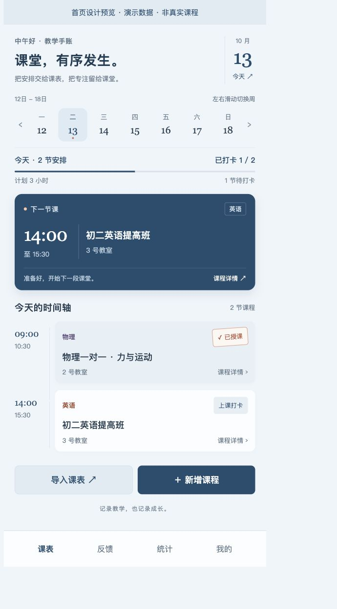

# 教师课表助手

一个面向教师日常工作的微信小程序：将课表导入、授课打卡、课后反馈和课时回顾串成完整流程。使用微信原生小程序与云开发，开发过程由 WorkBuddy 辅助完成。

## 功能

- **课表管理**：按周和日期浏览，支持每周固定课程、指定日期课程，以及课程新增、编辑和删除。
- **每日安排**：根据当前时间展示正在进行或下一节课程，按真实打卡记录展示每日进度。
- **批量导入**：支持文本、`.xlsx` 文件和图片识别；Excel 支持机构总表姓名筛选、个人课表和多工作表解析。
- **导入预览与去重**：确认后批量保存，按日期或星期、开始时间和课名跳过重复项。
- **授课打卡**：支持打卡与取消打卡，记录授课日期和时长。
- **课后反馈**：关联课程与上课日期，保留原文和 AI 整理结果，支持 Kimi、豆包渠道选择及失败回退。
- **反馈检索**：按课程名称、原文或整理内容搜索，支持本周、本月筛选与复制。
- **课时回顾**：展示本月打卡课节、实际时长、反馈数量，以及每周固定课程与计划时长。
- **订阅提醒**：定时检查次日课表，有课时尝试发送微信订阅消息。

## 页面设计

采用雾蓝背景、深海蓝重点区域与珊瑚橙打卡印章。首页使用紧凑日期、周导航、授课进度和时间轴，突出下一节课的时间；反馈页面采用信笺式排版，统计页面区分计划与实际授课。

[首页设计预览](design-preview/index.html)使用演示数据，仅用于展示视觉方向，不连接云端，也不替代真机验证。下载项目后用浏览器打开该文件。



## 技术结构

```text
miniprogram/        小程序页面、样式、工具函数与图标
cloudfunctions/     云端登录、导入、解析、模型调用和提醒
tests/              日摘要、日期切换与课程筛选测试
design-preview/     静态首页设计预览
docs/               设计说明与实施记录
notes/              开发复盘
```

小程序通过微信云开发 SDK 访问数据库和云存储。简单读写由客户端发起，Excel 解析、批量导入和模型请求在云函数中执行。定时触发器调用提醒函数，无需用户保持小程序打开。

| 云函数 | 用途 |
| --- | --- |
| `login` | 从微信调用上下文获取用户 OPENID |
| `parseScheduleExcel` | 下载 Excel，使用 `exceljs` 按规则解析课程 |
| `parseScheduleImage` | 下载课表图片，调用视觉模型提取课程 |
| `importCourses` | 按用户读取已有课程，去重并批量写入 |
| `polishFeedback` | 根据教师角色整理表达，支持渠道回退 |
| `scheduleRemind` | 检查次日课程并发送订阅消息 |
| `clearData` | 清理课程、反馈和打卡；使用前请阅读下方限制 |

## 本地运行与部署

1. 使用微信开发者工具导入项目根目录，填写自己的小程序 AppID；`project.config.json` 已指定小程序与云函数目录。
2. 开通微信云开发环境，将 `miniprogram/app.js` 的 `globalData.envId` 改为自己的环境 ID。
3. 创建 `courses`、`logs`、`feedbacks`、`remind_subs` 数据库集合。配置客户端权限，使普通用户只能读写自己的记录；使用两个测试账号验证数据隔离。
4. 在开发者工具中逐个上传并部署云函数，选择云端安装依赖。各函数依赖声明位于各自的 `package.json`。
5. 在云端配置下面的模型环境变量，不要把密钥写进代码、README 或提交记录。
6. 申请适用于实际业务的订阅消息模板，同步替换 `miniprogram/pages/profile/profile.js` 与 `cloudfunctions/scheduleRemind/index.js` 的模板 ID，并核对消息字段。
7. 部署 `scheduleRemind` 定时器，核验实际时区与北京时间。配置中的表达式为 `0 0 23 * * * *`。
8. 重新编译并使用真机预览，依次验证导入、周切换、打卡、反馈保存和订阅消息。

### 模型环境变量

| 变量 | 函数 | 说明 |
| --- | --- | --- |
| `KIMI_API_KEY` | `polishFeedback`、`parseScheduleImage` | Kimi 调用凭证，按需要分别配置 |
| `DOUBAO_API_KEY` | `polishFeedback` | 豆包调用凭证 |
| `DOUBAO_MODEL` | `polishFeedback` | 当前账号可用的豆包模型或推理接入点 ID |
| `GLM_API_KEY` | `parseScheduleImage` | 图片识别的 GLM 备用渠道凭证 |

当前 Kimi 配置使用 `api.kimi.com/coding/v1/chat/completions` 与 `k3`，GLM 使用 `glm-4v-flash`；请核对所持凭证是否支持相应接口和能力。豆包请配置自己的接入点，不要依赖源码的历史默认值。

两个 AI 函数的配置文件将函数超时设置为 60 秒，部署后需要核查是否生效。多个模型连续回退的累计时间仍可能接近函数上限。

未配置模型时，图片识别返回配置提示；反馈整理会在无可用渠道时返回原文并显示失败原因。手动录课、课表查看、打卡等功能不依赖模型。

## 验证

使用 Node.js 18 或更新版本执行：

```bash
node --test tests/*.test.js
```

测试覆盖当天正在进行与下一节课程、过去和未来日期、空课日、完成进度、周切换及固定/指定日期课程筛选。这些是离线逻辑测试，不证明云端权限、模型调用、订阅送达或微信页面渲染已经通过验证。

## 使用边界与待完善事项

- Excel 解析围绕已有课表结构实现，不保证任意机构表格均可解析；图片识别结果必须人工检查。
- 已打卡代表教师记录，不等于机构结算确认。每周计划统计仅包含固定星期课程，本月反馈按创建时间统计。
- 数据隔离依赖实际部署的数据库及文件权限；云函数写入用户数据时需显式保存用户归属。
- `clearData` 目前还会删除没有 `_openid` 的历史记录。多人部署前应把无主数据清理拆成独立管理流程，普通用户只清理自己的记录。
- 订阅记录按授权逐条新增，提醒尚需完善用户与日期去重、分页及发送日志；本地额度不代表平台实际可发送次数。
- 修改反馈原文后，需要重新整理并核对已有结果，避免保存旧版本的整理内容。
- 正式发布前核实最新主体资质、服务类目、备案、数据处理要求和实际使用费用。

此仓库不包含本地页面备份、开发者私人配置、上传课表或模型密钥。历史使用过的凭证如已暴露，应在模型服务端轮换。
